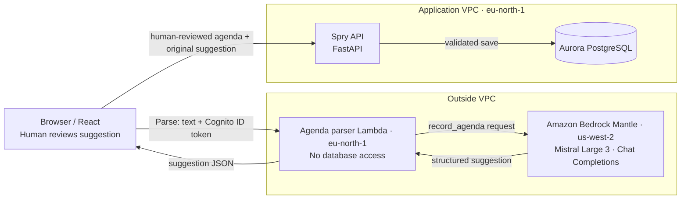

# Spry containers (C4 level 2)

The Bedrock response is only a suggestion. The parser cannot write to the database. The browser displays the suggestion for review, then saves through the normal API path.
